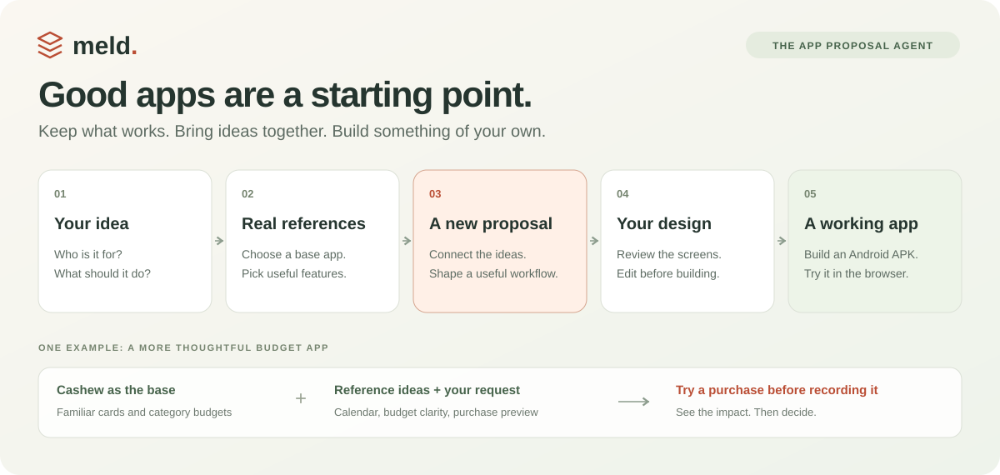
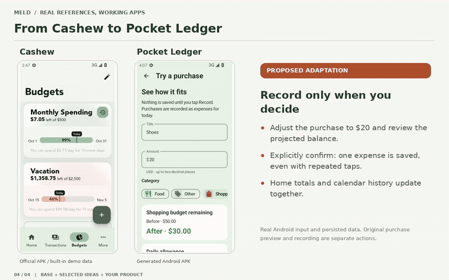
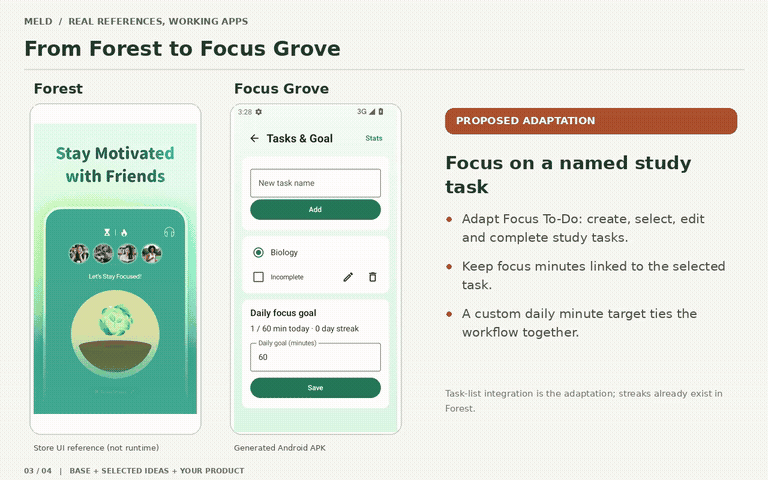

<p align="center">
  
</p>

<p align="center">
  <strong>An app proposal agent that turns inspiration into an app you can use.</strong><br>
  Describe what you need. Meld finds references, proposes a direction, and builds the design you approve.
</p>

<p align="center">
  <a href="#see-what-it-builds">Watch the demos</a> · <a href="#try-it">Try it locally</a> · <a href="docs/project-workflow.md">How it works</a>
</p>

## From inspiration to your own app

**A base to build on.** Choose an existing app as the foundation. Its screens guide the layout and visual language; its core workflow anchors the proposal.

**Ideas that work together.** Meld combines selected reference features and your requests into a product plan, explaining what to keep, adapt or add. You can see where each idea came from.

**You shape it before it ships.** Edit the proposal and design, then approve the build. Download the Android APK or try that same app in the browser, with build and verification reports alongside it.

## See what it builds

Two ideas, two bases, two working Android apps. Each animation compares the base with the generated result; click through for the full video.

### Pocket Ledger · try a purchase first

[](frontend/public/demos/pocket-ledger.mp4)

**Base: [Cashew](https://github.com/jameskokoska/Cashew)** — keep the rounded cards, category budgets and transaction flow.

**Borrow from:** Money Manager for calendar drill-down; Wallet for clear spent, remaining and over-budget breakdowns.

**The proposal:** preview a purchase’s effect on your category balance and daily allowance. Cancel without saving, or record it once.

[▶ Full video](frontend/public/demos/pocket-ledger.mp4) · [Design & checks](docs/pocket-ledger-example.md) · [Source](examples/pocket-ledger/)

### Focus Grove · study with a growing tree

[](frontend/public/demos/focus-grove.mp4)

**Base: [Forest](https://www.forestapp.cc/)** — keep the plant → focus → grow loop and a tree-centered screen.

**Borrow from:** Focus To-Do for tasks, Tide for sound controls, Loop for daily goals, Focusmeter for task-level stats.

**The proposal:** pick a study task, grow a tree, then see that task’s focus time against your daily goal.

[▶ Full video](frontend/public/demos/focus-grove.mp4) · [Design & checks](docs/focus-grove-example.md) · [Source](examples/focus-grove/)

<details>
<summary>About the comparisons</summary>

Forest is shown through store screenshots; the other three apps use actual APK footage. The generated apps are base-inspired adaptations, with simpler artwork in Focus Grove. Forest already offers sounds and statistics; Cashew already offers calendars and daily allowance. The proposals show how the ideas fit together, without claiming those individual features are new. Both generated demos passed device checks; visual equivalence with the originals has not been established. Details and evidence are linked above.

</details>

## Try it

With Node 24, JDK 17+ and Android SDK 35:

```bash
npm run setup
npm run dev
```

Open **http://127.0.0.1:4173**. New builds need model configuration; saved sessions and APKs stay local. The demo videos and Android source are included in this repo.

[Setup](frontend/README.md) · [Architecture](docs/project-workflow.md) · [UI skills](docs/ui-coding-skills.md) · [Demo details](docs/demos/README.md)
