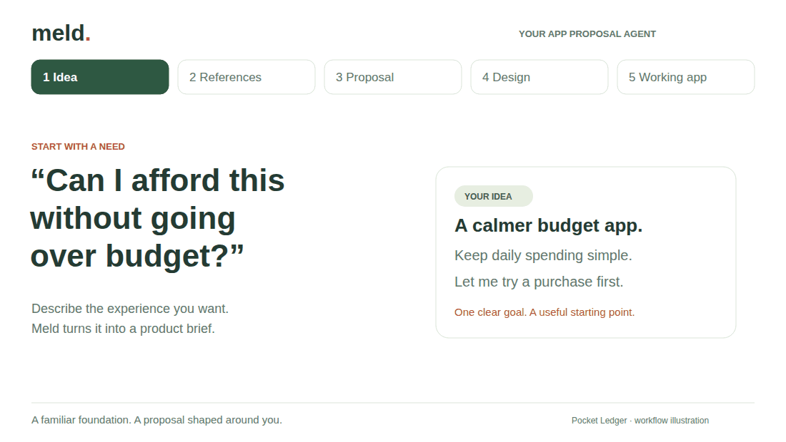

<h1 align="center">Meld</h1>

<p align="center">
  <strong>Good apps are a starting point. Build something of your own.</strong><br>
  An app proposal agent that brings references, your ideas, and a working Android app together.
</p>

<p align="center">
  <a href="#see-what-it-builds">Watch the demos</a> · <a href="#try-it">Try it locally</a> · <a href="docs/project-workflow.md">How it works</a>
</p>

[](docs/project-workflow.md)

- **Start with what works.** A real base app anchors the visual style and core workflow.
- **Make the ideas fit.** Meld turns reference features and your requests into a focused product proposal.
- **Shape it, then try it.** Edit the design, approve the build, and download or preview the Android app.

## See what it builds

Two ideas, two bases, two working Android apps. Each animation compares the base with the generated result; click through for the full video.

### Pocket Ledger · try a purchase first

[](frontend/public/demos/pocket-ledger.mp4)

**Base: [Cashew](https://github.com/jameskokoska/Cashew)** — keep the rounded cards, category budgets and transaction flow.

**Borrow from:** Money Manager for calendar drill-down; Wallet for clear spent, remaining and over-budget breakdowns.

**The proposal:** preview a purchase’s effect on your category balance and daily allowance. Cancel without saving, or record it once.

[▶ Full video](frontend/public/demos/pocket-ledger.mp4) · [Design & checks](docs/pocket-ledger-example.md) · [Source](examples/pocket-ledger/)

### Focus Grove · study with a growing tree

[](frontend/public/demos/focus-grove.mp4)

**Base: [Forest](https://www.forestapp.cc/)** — keep the plant → focus → grow loop and a tree-centered screen.

**Borrow from:** Focus To-Do for tasks, Tide for sound controls, Loop for daily goals, Focusmeter for task-level stats.

**The proposal:** pick a study task, grow a tree, then see that task’s focus time against your daily goal.

[▶ Full video](frontend/public/demos/focus-grove.mp4) · [Design & checks](docs/focus-grove-example.md) · [Source](examples/focus-grove/)

## Try it

With Node 24, JDK 17+ and Android SDK 35:

```bash
npm run setup
npm run dev
```

Open **http://127.0.0.1:4173**. New builds need model configuration; saved sessions and APKs stay local. The demo videos and Android source are included in this repo.

[Setup](frontend/README.md) · [Static overview](docs/images/meld-agent.svg) · [Architecture](docs/project-workflow.md) · [UI skills](docs/ui-coding-skills.md) · [Demo details](docs/demos/README.md)
