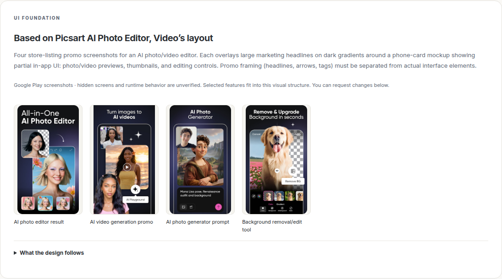

# Base app UI as the design foundation

The project workflow now reads the selected base app's screenshots before generating the user-facing design. It carries the same saved screenshots and layout analysis through high-level design, detailed design and Android source generation. It does not treat an earlier generated app as the original base.

## Reference selection

The resolver first uses an original-app capture configured under `MELD_UI_VALIDATION_CONFIG.bases[packageId]`, or a completed capture in that project's background reference analysis. A capture must have reference role, a valid observation manifest and the selected base package name. A generated replacement with a different package is rejected.

When runtime screenshots are unavailable, the resolver downloads up to six screenshots from the base's saved Google Play listing. The design page labels this source explicitly. Store images can show promotional framing and incomplete screens; their analysis separates visible app controls from marketing headlines, arrows and decorative gradients. This does not verify original runtime behavior or hidden screens. If neither source supplies usable images, design generation stops with a retryable explanation instead of inventing a reference.

Images are downloaded concurrently with bounded size, timeout and trusted image-host redirects. Their bytes and SHA-256 hashes are saved outside Git. JPEG, PNG and WebP are passed to the vision model with their actual media types.

## What the design follows

The visual analysis records navigation placement, main content proportions, hierarchy, typography, color roles, spacing and control groups. Every proposed screen must either cite a supplied screenshot and describe preserved layout rules and necessary adaptations, or explicitly say why it is a new, unobserved screen. At least one proposed screen must follow an observed base layout.

The design review page displays the actual reference thumbnails, their source and the layout rules. Selecting extra features does not replace this visual foundation. Explicit user appearance changes are allowed; a generic default style is a fallback. Branding, ads, account gates and unselected features are not imported with the layout.

Approving the outline pins its reference identity. Manual edits retain that reference; subsequent model edits reuse its verified images. The detailed-design job carries the reference into its saved brief. Detailed-design generation/review and Android generation/review receive the screenshots, not just a textual app name. Image hashes are checked before model calls and building. An older generated-app regression baseline cannot override the original-base design instructions.

## Latency and cache

The visual analysis is cached per project, base package and source snapshot: runtime manifest hash or listing image URLs. Saved bytes are immutable and checked on reuse. Changing the base or source snapshot selects a different reference; refreshing the same snapshot reuses its bytes rather than silently replacing evidence.

The successful initial Image Editor visual-analysis call took 71.113 seconds. The final outline generation with cached references took about 85.1 seconds, including local orchestration. These are separate measured steps, not a fresh full-APK pipeline timing. Earlier budget-rejected attempts are retained.

The Image Editor probe read its four-image cache in 13.5–36.4 ms across three samples. That measures local reference loading only. First-time visual analysis adds a model call, and the outline model still receives images on cached runs, so total design latency is not guaranteed to match the previous text-only flow. Full APK/native analysis is not a prerequisite for showing a store-reference-based design.

## Image Editor example and verification

The new saved design example is [Image Editor — Base UI](http://127.0.0.1:4173/?project=project-fa3cf644-7891-466a-b2f0-8d9192cbc1d7). It uses four real Picsart listing screenshots. The final saved outline is `hl-v0004-b0b2cf1cba2b`: large photo preview, compact dark toolbar with white icons, bottom icon-label tools and Cancel/Apply tool panels. The old generated editor remains a separate delivered project; this new example is a design awaiting approval and does not claim a newly rebuilt APK.

The example removes the older sample's custom instruction to preserve its warm palette. It asks the model to follow visible base UI and integrate the existing offline still-image features. Screens absent from the listing must remain explicitly proposed. This is visual grounding from store evidence, not a claim of pixel-identical Picsart or commercial-app equivalence.

Repository tests cover immutable screenshot bindings, screen mappings, detailed-design image attachments, changed-image rejection, screenshot download boundaries, missing references, wrong original-app identity, and the actual browser review/edit/approval handoff using synthetic fixtures. Live model execution and browser verification of the saved example are recorded separately in ignored `outputs/base-ui-integration/`; synthetic fixtures do not establish real APK fidelity.

Actual verification: 110 pipeline tests passed; the full web/backend run passed 203 tests with seven live-market tests skipped. After preserving existing base choices during feature edits, all 13 targeted base-UI/high-level tests passed. Backend/frontend typechecks and the production client build passed. The live model generated the saved design with attached Picsart screenshots. Browser checks at 1440px and 390px verified the reference panel and screen mappings, four HTTP-200 image downloads with matching hashes and JPEG types, no horizontal page overflow, and no page errors. The independent API serves the same reference images. No new Android APK was built in this integration task.
