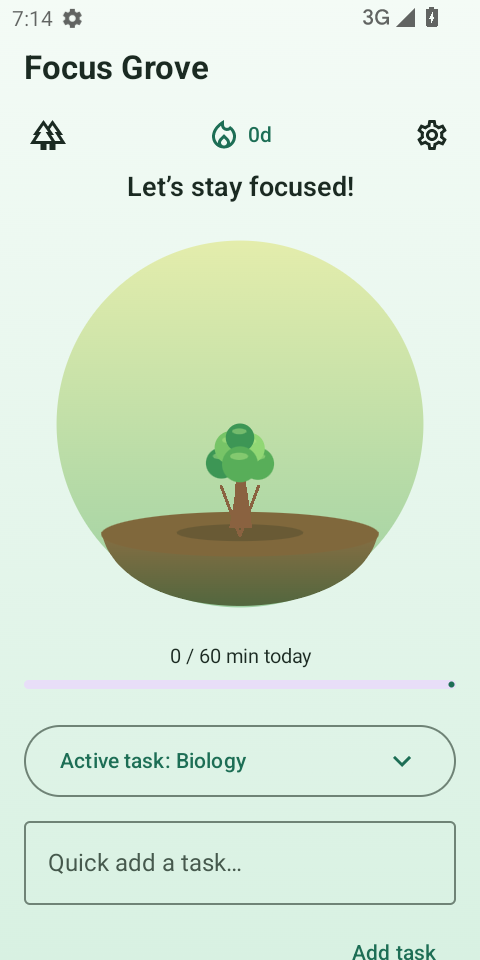
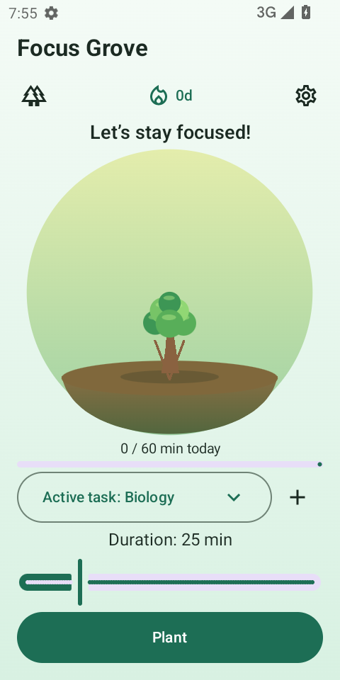
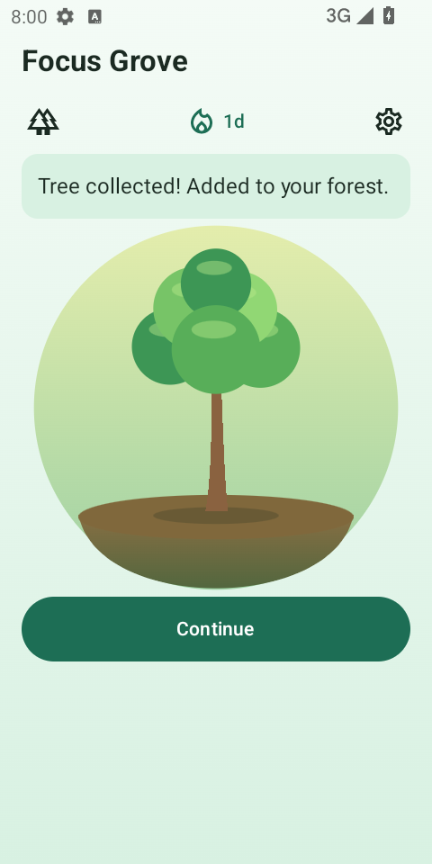
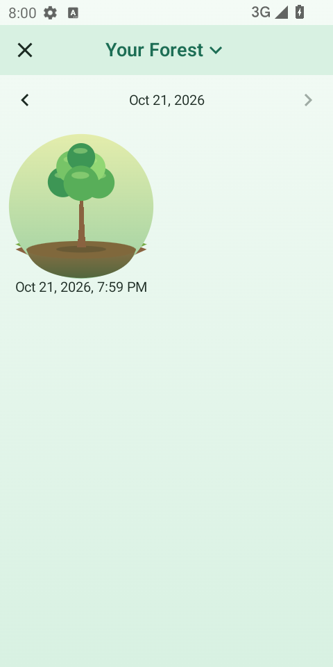
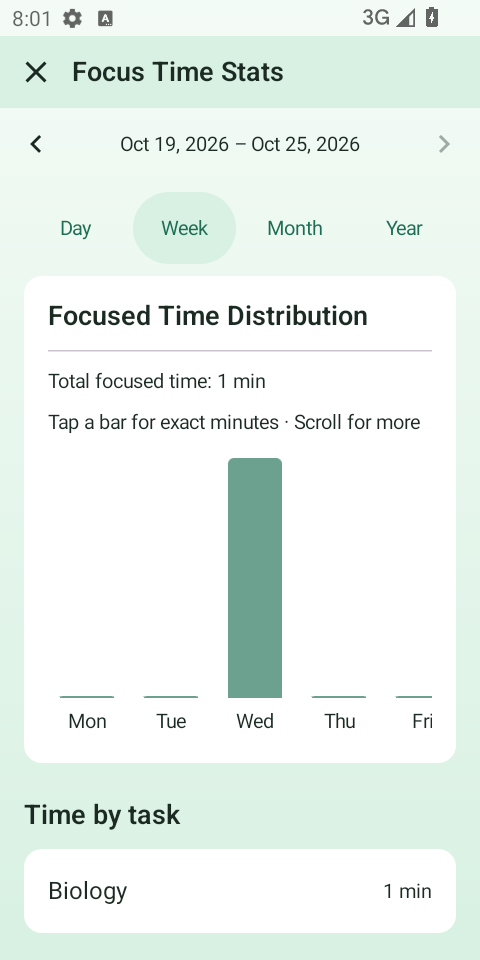
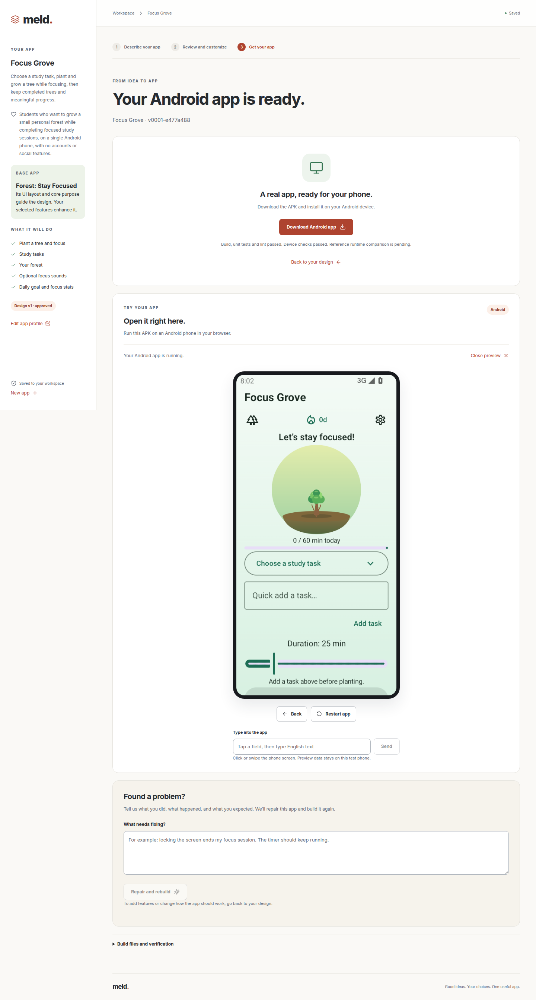

# Focus Grove: five-reference tree-focus example

The example uses Forest (`cc.forestapp`) as its sole base and UI foundation. Four selected references contribute specific enhancements; they do not replace that base.

Watch the [base/app comparison video](../frontend/public/demos/focus-grove.mp4) or open `/demos/index.html` on the running website. Forest appears as store UI references; the generated side is the actual APK. The video includes a real one-minute session condensed to 5× speed, task completion and task statistics.

Reference attribution does **not** mean Forest lacks the feature. Forest already offers ambient sounds, focus analytics, custom tags and streaks ([official feature overview](https://www.forestapp.cc/)). The demo's proposed adaptation is its lightweight editable/completable study-task list and custom focus-minute-goal integration. Tide/Loop/Focusmeter guide supporting behavior; their broad sound/statistics/streak capabilities overlap with the base. The candidate artwork remains simpler than Forest's; implementation tests do not establish equivalent visual quality.

| Reference | Selected contribution |
| --- | --- |
| Forest | Plant, focus, grow and collect trees; top utility bar, central circular tree and timer, forest overview |
| Focus To-Do | Study task creation, editing, completion, selection and task-linked focus time |
| Tide | Locally generated rain, wind and forest ambience with playback and volume controls |
| Loop Habit Tracker | Daily focus-minute goal and consecutive-day progress |
| Focusmeter | Actual completed minutes by period and study task |

Fresh Google Play listings and sampled recent reviews were collected for these five explicitly selected apps on 2026-10-21. Their ranking is only within that selected set; this is not a full market search. The four Forest visual references are listing screenshot positions 7, 4, 6 and 3: focus, forest overview, statistics and settings. Promotional framing and friend avatars are excluded from the proposed app. Original Forest APK execution was unavailable, so these references establish observed store UI, not original runtime behavior.

The design uses the [Base App UI Design skill](../pipeline/skills/base-ui-design/SKILL.md) in high-level and detailed design. Coding receives only the three [native compatibility profiles](ui-coding-skills.md). Saved model requests separately establish that the design skill was present in design calls and absent from coding calls, and the native profiles were present in coding and absent from design calls.

The example's approved scope permits one durable session. Rotation, backgrounding and screen locking preserve it; only confirmed Give Up abandons it. A session can last 1–120 minutes, including a real one-minute demonstration. Completed sessions create one collected tree and contribute minutes; abandoned sessions do not. There are no accounts, purchases, streamed sound libraries or system app-blocking claims.

## Reproduction and evidence

Open the existing project with `/?project=project-282843ad-103f-4458-9a40-d192b65be2ba`. On the local delivery host, `MELD_PROJECT_EXAMPLE` selects this project for the homepage once its current build passes. Saved local run artifacts are under the ignored `outputs/forest-example/` directory; they contain the selected-reference report, original screenshot selection, approved outline, stage proof, model attempts and delivery verification. APKs, raw model logs and large run artifacts remain outside Git.

The opt-in native harness targets the recorded 480×960 Android emulator and the supplied Material3 template; other device configurations need their own scenario adapter verification. The harness is `frontend/tests/forest-native.py APK GENERATED_PACKAGE_ID`, with `MELD_ANDROID_ADB`, `MELD_ANDROID_SERIAL` and `MELD_NATIVE_QA_OUTPUT` set to a dedicated test emulator and output directory. It installs and clears only the isolated generated candidate. UI actions create outcomes; the harness does not write app source, session databases or the clock to manufacture completion.

Validation of a generated APK, its runtime interactions, original-app screenshot comparison and release performance are separate claims. A debug emulator pass does not establish physical-device behavior, original Forest runtime equivalence or release performance benchmarks.

## UI from the actual APK

Before the UI repair, the candidate placed Plant below secondary task-entry controls. Both Home screenshots show Biology selected with the same default duration and daily goal. The revised Home collapses that entry form after task selection, measures its real header/control heights, and reserves the remaining space for its central tree. Completion and abandonment retain their corresponding artwork and feedback until Continue, including ordinary process restart.

| Before UI repair | Final verified candidate |
| --- | --- |
|  |  |

The audio device gate also caught a real playback failure. Static AudioTrack writes reset the destination buffer offset, so the original chunked upload was unsuitable ([Android API reference](https://developer.android.com/reference/android/media/AudioTrack)). The revised implementation generates original PCM/WAV loops locally, prepares an app-owned MediaPlayer off the main thread, and coordinates cancellation and deadline shutdown. Tests cover encoding and the production playback owner. Device checks inspect Android playback state; host speaker output is disabled in this headless emulator, so acoustic listening is not claimed.

## Validation on the delivered candidate

Build `job-47927d02-5859-42e0-b018-39a47733e2ee`, APK SHA-256 `6fa97d885f2569cba3455a26929df890aa0c6157170a3edd35af02cf98e48e86`:

- APK assembly, 44 production JVM tests and Android lint passed.
- All 11 native acceptance groups passed on API 33, x86_64, 480×960. This includes task CRUD, landscape keyboard editing, goal validation, real playback/pause/volume, rotation/background/lock/restart, cancellation/abandonment, real one-minute completion, audio shutdown before foreground resume, exactly one earned tree, streak and daily/weekly task minutes.
- Implementation review passed with four actual candidate screenshots and the original base store references attached. Candidate image hashes and the native APK hash are recorded in the downloadable build report.
- Website regression: 213 passed, 7 skipped; production web build and backend typecheck passed. Pipeline unit tests: 110 passed. Synthetic orchestration fixtures are separate from the live model and device run.

The coding skill fingerprint is `7341041498bc4ebc857353d0197b1b28389402157b6af1045544db98426c3d61`. The original/candidate runtime-comparison flag remains false: candidate screenshot-informed review does not establish original Forest runtime equivalence. Remaining follow-ups include atomic acknowledgement across the narrow database/preferences crash boundary, history-write scaling, and verification on additional APIs and font sizes. Debug-emulator results do not establish release-performance improvements.

| Completed session | Earned forest | Actual weekly minutes |
| --- | --- | --- |
|  |  |  |

The live website homepage now exposes **Open app example** for Focus Grove. Delivery verification opened that saved project, downloaded all four artifacts and matched their hashes to the recorded build, checked desktop and 390px mobile layout, and booted the same APK in the browser Android preview. Restart and pointer input opened the actual Tasks & Goal screen; no browser errors were observed.

