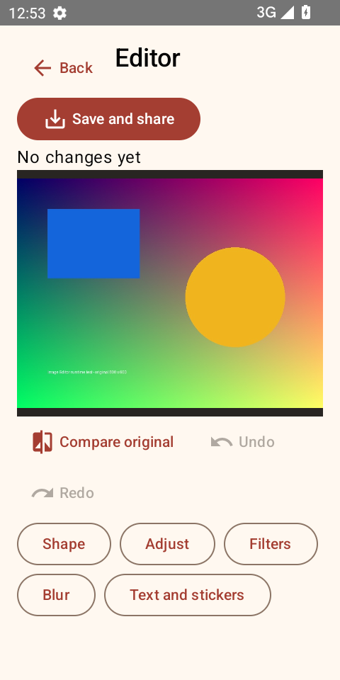
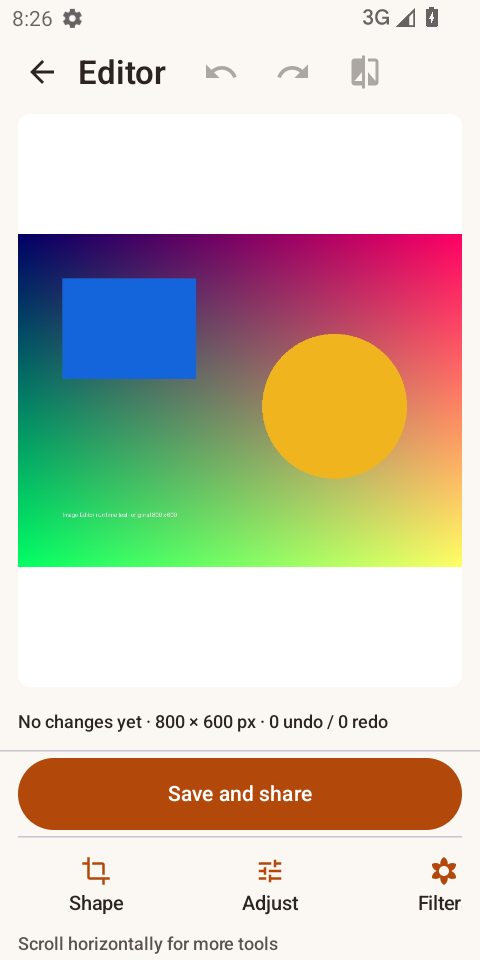
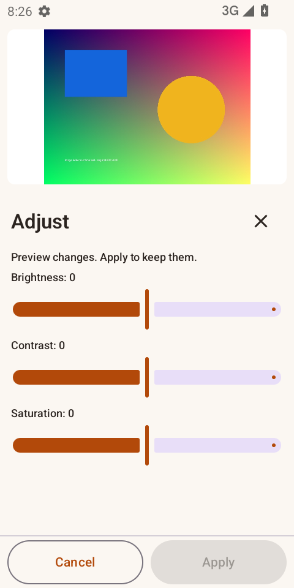

# Image Editor: base-app pipeline run

## Product and reference choice

The 2026-10-16 run preserves the previous Image Editor product's photo-editing workflow. Picsart (`com.picsart.studio`) is the market reference foundation, with selected Canva photo-editing and InShot still-filter enhancements. It does not combine separate video, collage or AI products into the app. Reference preparation is best effort; market-assisted source descriptions do not establish APK/runtime evidence for every reference.

## Saved project and design

Open the web history entry **Image Editor**, project `project-633b479e-0345-4f89-add6-112956334a80`, or append `?project=project-633b479e-0345-4f89-add6-112956334a80` to the web URL. This is a new run; the previous failed project is preserved.

The run uses approved readable revision `hl-v0002-261f581983cb` and detailed revision `v0001-29756c62`. Reference preparation runs alongside feature customization. The foundation and selected enhancements carry into the readable design, approved detailed design and generated Kotlin app.

Final build: `job-f8dae7f2-2f29-4d58-a55c-e987db9af35a`. APK SHA-256: `e9951f5099d90d80fd55e81fcfb65a191c7761572002bd04954605ce4095dad3`.

## Results and evidence

Gradle compilation, lint and 57 JUnit tests passed. The implementation model review accepted the primary workflows and recorded follow-ups for sustained blur painting, extreme text/sticker sizing, bundled fonts and accessibility focus. The APK remains an MVP with these explicit limitations.

Thirteen actual Android 13 emulator cases passed against the final published APK hash: import, rotate, undo/redo, rotated-copy export, crop, crop followed by adjustment, text, stickers, edited JPEG dimensions/pixels, original-file integrity and Android Sharesheet launch. No message or share recipient was submitted. These checks supplement the build worker’s static report; they do not establish behavior on all devices or all failure paths.

A 4000 × 3000 image imported and accepted a painted blur edit (about 34 seconds including preview and Apply). Its full-resolution blur export exceeded the 45-second test budget and remained in preparation during extended observation. That large-image export is **not verified** and remains a performance limitation; it is not counted among the 13 passing ordinary-image cases. Original failed test reports are retained in the ignored output directory.

Ignored local artifacts live in `outputs/image-editor-base-run/`: `image-editor-v1.apk`, `run.json`, `user-doc.md`, `final-design.json`, `developer.html` and `build-report.json`. The web project serves its own APK and design downloads from persisted workflow storage; the local copies are conveniences, not a substitute for history.

## Pipeline corrections exercised

The run exercised reference-list repair with full design revalidation, bounded model-output retries, exact-file repair checkpoints and recovery from interrupted reviews. Android scaffolding supplies a restricted FileProvider for actual image sharing. Image workloads request Android large-heap capacity. Same-design rebuilds reuse the saved implementation, then compile, test, lint and review it again. Native repair findings must match the tested APK hash. Failed attempts and their original evidence remain available locally; generated APKs, caches, model logs and credentials stay outside Git.

## 2026-10-18 rerun and pipeline repair

The rerun is a separate saved project, `project-eb47b8ed-53a7-4b41-978d-28fb8743c2a9`, with readable outline `hl-v0001-e2f9c4679096` and detailed revision `v0001-5d0af697`. Open it with `?project=project-eb47b8ed-53a7-4b41-978d-28fb8743c2a9`. It reuses the exact saved market snapshots and partial reference preparation; this is not a fresh market search or newly completed analysis of the commercial reference APKs.

Kevin's saved feature selections, Draft-7 response schemas, interrupted design recovery, exact-file repair checkpoints and delivered-app repair UI are integrated. Additional corrections keep live workers from being recovered by another local server, prevent emitted pipeline modules from repeatedly restarting Vite, retire replaced Kotlin files during repairs, and correct invalid repair plans before generating modules. Compile/test/lint and implementation review now precede configured native and screenshot gates. Device failures cannot be cleared by an unrelated successful compilation.

Three runtime reference scenes (home, editor and adjustments) were captured from the previous generated Image Editor APK with REA, sealed evidence and hashes. These are our own MVP baseline, not original Picsart screenshots. The observer can reset the Android activity task without clearing app data and tap a precise point within a matched node, which handles the system document picker without opening its preview activity.

The new outline and detailed design were generated and reviewed with Claude. When the code repair reached the authenticated Claude session limit, its completed modules and failed attempt were preserved; an explicitly configured authenticated Codex CLI continued the remaining build repairs and review. Provider provenance remains in each saved response. The default provider remains Claude unless configured otherwise. A layout-only probe is kept separately and is not an accepted delivery.

Repository checks passed: 106 pipeline tests; 199 web/backend tests with 7 live-market tests skipped; backend typecheck and the production web build. The opt-in image-editor device suite checks real exported dimensions and pixels, filters, undo restoration, overlays, source-file integrity, Android sharing and a full-resolution painted-blur export. Device and final UI results are recorded separately below.

The rerun additionally exposed a stale REA adb path, a window-local keyboard-inset assumption, and native-process signals being misclassified as app defects. Capture now preflights before model calls; actual captured UI assertions feed bounded repairs, while capture infrastructure failures stop. Native SIGTERM/null-exit reports retry the accepted source and ignore repair plans originating solely from that interruption. Deterministic tests cover both classifications and the keyboard coordinate conversion.

Device QA found actionable UI defects in the retained candidate: offscreen tool actions, Save displaced by element controls, thumbnails computed from the pending filtered preview, and Share Retry returning to the saved screen without opening the Sharesheet. The repair and QA also cover image-relative initial caption sizing, transformed element geometry, original publication timestamps, and caption selection binding. Individual failed candidates are retained; their partial passes do not establish final delivery.

## Accepted rerun

Open [the delivered Image Editor](http://127.0.0.1:4173/?project=project-eb47b8ed-53a7-4b41-978d-28fb8743c2a9) in the running local web app. Build: `job-f2a4ddd2-a14d-4587-a05b-e9644a8059f6`. APK SHA-256: `0346ac7889e2957787c7b77ed1973b7de6fce3c7f4eec690b7123f3c7848f01d`. The web delivery exposes the APK, approved design, build report, native report, UI validation and a self-contained screen comparison; all six artifacts have recorded hashes.

The UI now groups Undo/Redo/Compare in the top bar, keeps Save outside the scrolling decoration controls, exposes the horizontal tool strip with a scrolling cue, and fits Brightness, Contrast and Saturation above Apply/Cancel. The tool strip spans the full workspace in landscape. Actual keyboard tests cover portrait, landscape and rotating with an unfinished caption draft. Square-crop geometry uses committed dimensions, avoiding the rapid Rotate → Square preview race.

| Previous generated MVP | Accepted editor, same synthetic photo |
|---|---|
|  |  |

Validation is separated by evidence type:

- Repository: 106 pipeline tests and 199 web/backend tests passed; seven live-market tests were skipped. Backend typecheck and the production web build passed. The reload/forwarding fixture passed three additional repetitions after its cancellation cleanup fix.
- Generated app: Gradle compilation, lint and 37 JUnit tests passed. Implementation model review passed before the runtime gates. The tests exercise production pixel replay, history, geometry, bounded transfers, reducers, export concurrency and durable receipts; injected ports do not establish Android behavior by themselves.
- Device: all 23 interactions passed on the recorded Android 13 x86_64 emulator against the delivered APK hash. These include actual exported dimensions/pixels, unchanged original bytes, selective blur, overlays, keyboard/rotation, Android sharing and an injected sharing-cache failure followed by Retry. No recipient was selected or message sent.
- Visual: REA captured home, editor and adjustments with screenshots, hierarchies and foreground-window evidence. Every required assertion and all three model comparisons passed against the delivered APK. Earlier capture/visual failures remain in their original attempt directories. The live visual loop identified missing tool discoverability and clipped adjustments, repaired the UI, and reran the gates.
- API: the original `a study timer` input returned HTTP 200 with two clarification questions from the live `/api/intent/clarify` endpoint. The independent API server also returned the same accepted build and APK hash as the web server.
- Browser delivery: all six downloads returned HTTP 200 and matched their recorded hashes. The downloaded native and visual reports bind to the delivered APK. The real browser Android preview booted that APK; pointer input opened the system photo picker, and Restart, Back and Close worked without browser errors. The first pointer probe used the starting session's zero dimensions; the corrected verifier reads ready-session dimensions before tapping.

The final 4000 × 3000 painted-blur export preserved full resolution and completed its measured export step in 28.394 seconds, within the 45-second budget that the older MVP exceeded. The painted preview-plus-Apply step took 27.217 seconds, including test-driver overhead; large-photo previews remain a responsiveness follow-up. Pending Warm selection changed the None thumbnail by a mean RGB difference of 0.0; Share Retry opened the Sharesheet without another permanent JPEG; the initial 12MP caption had a 137-pixel ink height.

Scope remains explicit: this comparison uses our previous generated MVP, not original Picsart. Store snapshots and partial reference preparation were reused; fresh commercial-APK/JNI equivalence and full REA reconstruction closure were not established. Other devices and every failure path are not covered. Large-photo interaction latency and the anchor of a partially cropped decoration when dragging remain recorded follow-ups.

Local detailed evidence is retained in `outputs/image-editor-rerun/`, including `acceptance-summary.json`, `delivery-verification.json`, `independent-api-final.json`, the source attempt directories and failed probes. APKs, model logs, credentials and large run artifacts remain outside Git; the three small screenshots above are copied unchanged from their hashed capture artifacts.
