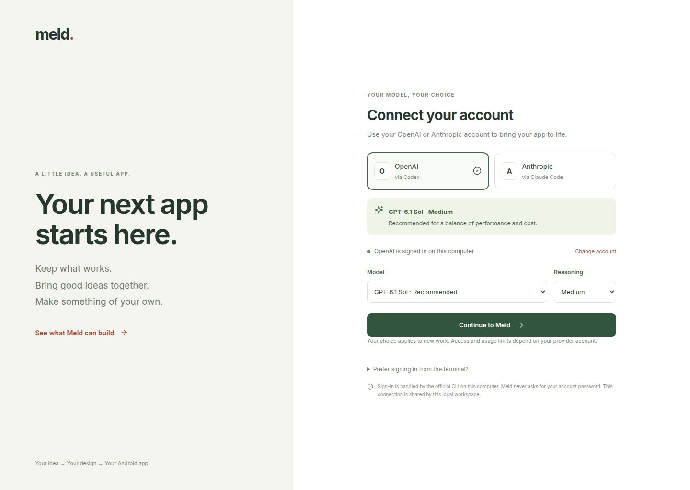

# Account connection and model choice

Meld runs locally. Connect **OpenAI through Codex** or **Anthropic through Claude Code**, choose a model and reasoning level, and continue into the studio. Existing CLI sign-ins are detected automatically. You can change the choice from the workspace header.

We recommend **GPT-6.1 Sol · Medium** for a balance of performance and cost. This is Meld’s starting recommendation; model access and usage limits depend on your account. Compare results for your own apps. [Official OpenAI model guidance](https://developers.openai.com/api/docs/guides/model-selection), [GPT-6.1 Sol](https://developers.openai.com/api/docs/models/gpt-6.1-sol), [Claude model IDs](https://platform.claude.com/docs/en/models/overview).



## Sign in

Install the [Codex CLI](https://developers.openai.com/codex/cli) or [Claude Code](https://code.claude.com/docs/en/quickstart) on the computer running Meld. Start Meld and select a provider. **Sign in** starts its official CLI authentication flow. Open the provider link shown on the page and complete sign-in there. For OpenAI, enter the device code when prompted; your account may need device authentication enabled. For Anthropic, paste the authorization code into Meld if the provider displays one. The page checks for completion automatically.

You can also sign in from a terminal on the same computer:

```bash
codex login --device-auth
# or
claude auth login
```

Then choose **Check connection again** in Meld. Select the model and reasoning level, then **Continue to Meld**. A detected existing CLI login lets you continue immediately. Missing CLIs, expired authorization, cancellation and provider failures leave the page available for retry. The login flow expires after ten minutes.

Credentials stay under the official CLI’s control; Meld does not collect provider passwords or implement its own provider OAuth client. Sign-in output is kept temporarily in memory, and only allowlisted authorization links/device codes reach the browser. Authorization codes are not stored in the project. **Disconnect from Meld** clears the workspace’s model choice and cancels a pending login; it does not sign the official CLI out.

## What the choice controls

The selected provider, model and reasoning level apply to idea clarification, listing-feature summaries, base-UI analysis, product outlines, detailed reference analysis/design, code generation and implementation review. The same setting reaches the detailed pipeline subprocess. Existing configured defaults still serve older API callers when no choice has been saved.

The backend captures the selection in an asynchronous request context so switching models does not change model calls already queued by that request. New requests use the newly saved choice. A resumed detailed pipeline retains its recorded model configuration so its cached stages and fingerprint remain reproducible. Saved feature summaries include provider/model/effort in their cache identity. Existing completed artifacts remain unchanged; selecting a model does not rebuild an app automatically. CLI availability is checked separately from model entitlement; generation reports a provider error if that account cannot use the chosen model.

The non-secret choice is saved atomically in ignored `frontend/.meld-cache/model-selection.json`. No API key is needed for this CLI account path. Existing provider environment settings remain available for developer workflows; credentials are not sent to the browser. Optional `MELD_CODEX_BIN` and `MELD_CLAUDE_BIN` select installed CLI executables.

## Local workspace scope

This is a **local account connection**, not a website membership system. Account-management endpoints require a loopback connection, a localhost host and a same-origin request. The model choice and CLI login are shared by this local workspace. Meld does not provide per-user project ownership, session-separated credentials or public multi-user account login. A public deployment needs a separate identity/session and credential-isolation design before these local connections can be offered to remote users.

[OpenAI authentication](https://developers.openai.com/codex/auth) · [Claude Code authentication](https://code.claude.com/docs/en/authentication)

## Verification · 23 October 2026

- Pipeline: **110 tests passed**. Frontend/API: **220 distinct tests passed, 7 skipped**, across the full run and the corrected draft-seeding test recheck. Seven feature-summary regression checks were also rerun after isolating concurrent summary-call directories.
- Backend/frontend typechecks and the production build passed. Desktop (1440 px) and mobile (390 px) login screens rendered without browser errors or horizontal overflow.
- Real **GPT-6.1 Sol / Medium** and **Claude Sonnet 5.5 / Medium** calls returned validated JSON. Sol also completed the actual idea-clarification schema and extracted features from a synthetic listing; the repeated summary request used its saved cache.
- Fresh, isolated official CLI login processes produced OpenAI’s device URL/code and Anthropic’s authorization URL. Those probes were cancelled before account consent; automated completion/cancellation/code-entry checks use test processes. A fresh human-approved OAuth grant is not claimed by these checks.
