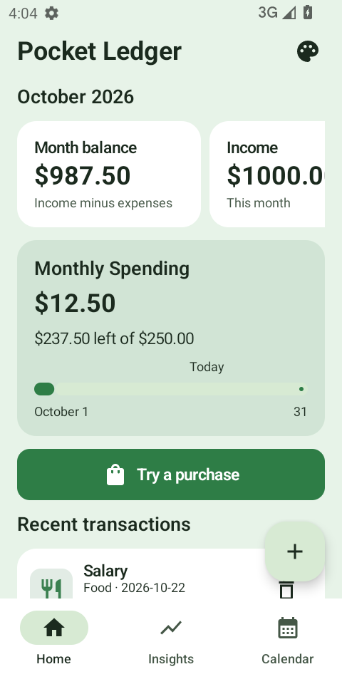
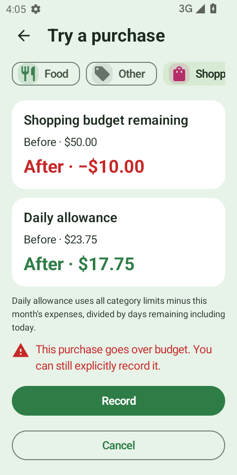
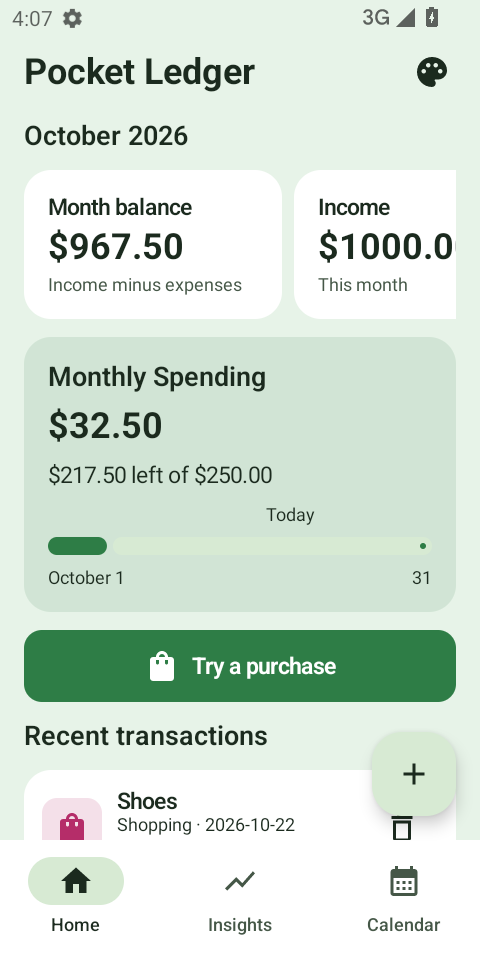

# Pocket Ledger

Pocket Ledger is a local expense tracker built around Cashew's visual foundation, with a dedicated purchase-preview workflow. Open the saved delivery project at `/?project=project-a92b60ad-6e5a-445d-94f4-4b0f5d2c6064`; watch the comparison at `/demos/index.html`.

| Source | Preserved or adapted |
| --- | --- |
| [Cashew](https://github.com/jameskokoska/Cashew) — base | Rounded pastel surfaces, spending overview, category budgets, transaction entry and history. |
| [Money Manager](https://help.realbyteapps.com/hc/en-us/articles/360043325533-Home-tab) | Calendar day drill-down for browsing transactions. |
| [Wallet](https://support.budgetbakers.com/hc/en-us/articles/7076953735314-Setup-Budgets) | Explicit spent / remaining / over-budget breakdown. |
| Proposed integration | Try a hypothetical purchase, compare its effects without changing the ledger, then explicitly record one expense or cancel. |

Cashew already has budgets, calendar views, upcoming transactions, goals and a daily spending allowance. These are not claimed as new. The proposed workflow is an integration for this generated demo, not an assertion of uniqueness across every Cashew version or the market.

The original base used for video capture is the official GitHub Android release 5.3.4+396. Its built-in Preview Demo supplies the visible sample data. Current store screenshots separately inform the design, so store appearance and this pinned APK are distinct evidence sources. No Cashew source code or bundled artwork is copied into the generated application.

## Reproduce the generation

From the repository root with Node 24, configured model access, the project's Android SDK, and the Python market collector dependencies:

```bash
python3 scripts/demos/collect-budget-references.py
node --import ./pipeline/node_modules/tsx/dist/loader.mjs scripts/demos/budget-example.ts --outline-only
node --import ./pipeline/node_modules/tsx/dist/loader.mjs scripts/demos/budget-example.ts
```

The runner saves listing evidence and immutable model/build artifacts under ignored `outputs/budget-example/` and `frontend/.meld-cache/`. It uses the real high-level design, detailed design and Android generation workers. `--native` additionally enables this demo's opt-in device acceptance harness on `emulator-5580`; that device must already be booted and dedicated to the run. Fresh clones generate new project IDs rather than importing local saved sessions.

The app uses local data and USD amounts; it does not connect to banks, move money or synchronize across devices. APK build, unit tests, lint, actual device interactions and original/candidate visual equivalence are separate claims. See the recorded verification below for what was actually checked.

## Verified delivery

Build `job-c087b2b4-33c6-4a90-9dff-dc4a28435d7e`, APK SHA-256 `090234c0ec7eb3e9471263f20fd7283659b4edb1fef0708c540abe88ec880113`:

- Debug APK assembly, 12 JVM tests and Android lint passed. Tests include strict cents, period calculations, pure preview and purchase-date reconciliation across a month boundary.
- Eight real native acceptance groups passed on API 33, x86_64, 480×960: empty state; saved category limits; income/expense totals; non-destructive over-budget preview and cancel; fractional-cent rejection; rotation preserving the draft; exactly one confirmed purchase and restart; calendar editing and confirmed deletion.
- Transaction snapshots are read-only SQLite copies. Every financial state change comes from visible UI actions, without database seeding or device-clock changes.
- Implementation review passed with four candidate device screenshots and the original store references attached. `runtimeVerified=true`; `visualVerified=false`: original/candidate scenarios were not matched for runtime-equivalence testing.
- The published [source snapshot](../examples/pocket-ledger/) matches the model output compiled for this build. [Provenance](../examples/pocket-ledger/provenance.json) records source hashes and review limitations.

| Monthly overview | Purchase sandbox | After explicit recording |
| --- | --- | --- |
|  |  |  |

Source-review follow-ups remain: compact the Insights period cards, coalesce scroll-state serialization, refresh an already-open preview at date rollover, and rebuild stale failed-write retries after edits. Broader API, keyboard/font-scaling, theme and interrupted-write scenarios are not covered by the recorded device suite. These are explicit limits of this demo, not claims of production financial-service readiness.

The delivery website was checked on desktop and at 390px width. Both comparison videos played; both example APK downloads matched their recorded hashes. The same Pocket Ledger APK ran in the browser Android preview, with restart and pointer input opening its theme controls. Website regression covered 215 passing checks and 7 skips across the main run and isolated rechecks; the pipeline's 110 tests passed. Production web build and backend typecheck passed.
